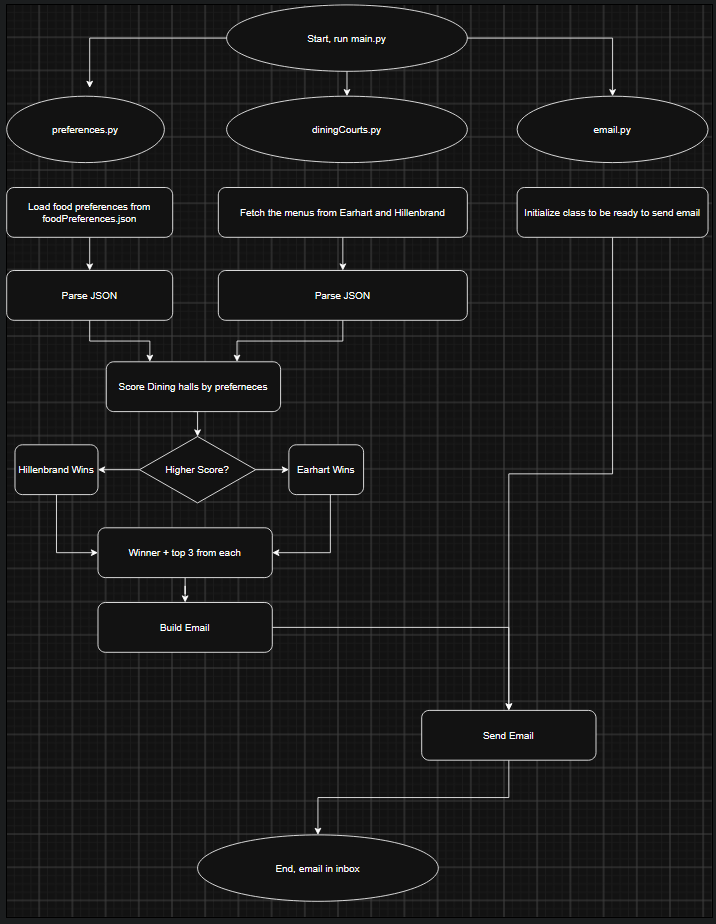

# Purdue Dinning Decider

## MVP
Fetch information from both Earhard and Hillenbrand. Create a JSON file detailing what foods the user likes. Usr the list of prefeed fooded to find witch dinning court is better that day and send an email to youself that details the better dinning court and what the top 3 meals are in both.

## Future Plans
Create an algorithem so foods dont become repetitive. Run autonomously every mornining. Include info about diet and allergy restrictions. 

### Problem Statement
On any given day, I don't know which dining hall is serving better food next to my dorm, Hillenbrand or Earhart. The only way to know is to look up both dinning halls and compare them witch is tedious.

### Idea / Solution
I am going to build an app that compares the menu of the two dinning courts with information about what food I like. Once it compares it, it will email me the results of what location Earhart vs Hildebrand is better on a per meal basis.

### Eisenhower Matrix
[View Eisenhower Matrix](docs/EisenhowerMatrix.pdf)

### Tech Stack
* Python
* fetching Purdue's dinning API through python's requests library
* Google Cloud API to send the email to myself.

### Chunked Build Plan
* Setup git repo
* Pull raw JSON for 1 dinning court
* Parse the raw JSON 
* Parse user defined information about preferred meals
* Create a score based off the user defined meal information and the dining court info
* Pull data from the second dinning court and compare to the first
* Setup Email API send a test email though code
* Make the email contents send information about what dining court is better
* Add the top 3 meals from each dining court to the email

### System Diagram
